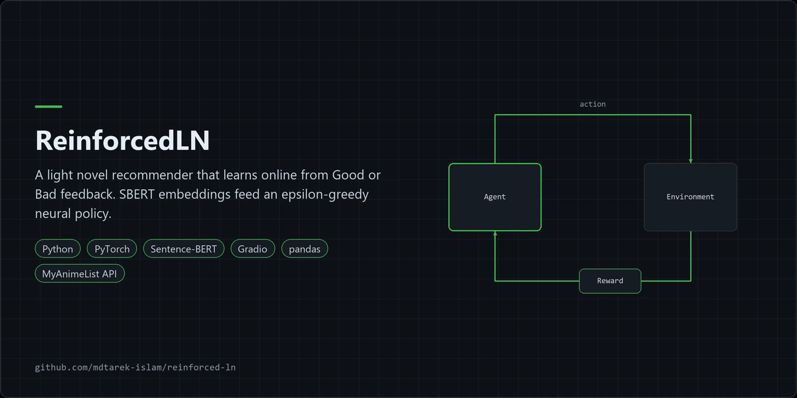
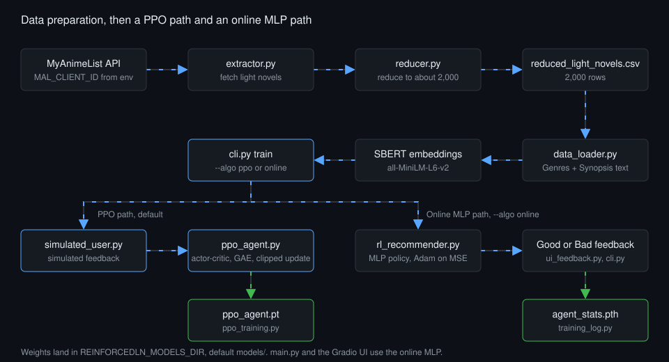
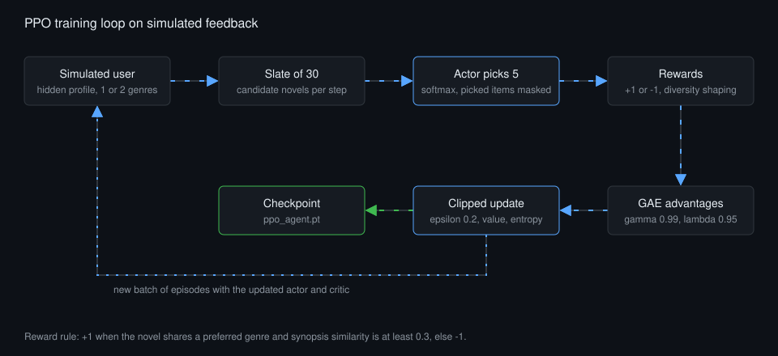

<p align="center"></p>

# ReinforcedLN

A light novel recommender that learns from feedback, with a PPO actor-critic trained on simulated users and an online MLP trained on Good or Bad ratings.

## Overview

ReinforcedLN loads `reduced_light_novels.csv` (2,000 rows), joins Genres and Synopsis, and embeds each novel with SBERT `all-MiniLM-L6-v2`. It ranks novels against a free-text synopsis. `python cli.py train` now trains a PPO actor-critic by default, using a simulated user for offline feedback. The original online MLP stays available with `--algo online`, and `main.py` and the Gradio UI still use it.

| Layer | Technology |
|---|---|
| Language | Python |
| Embeddings | sentence-transformers, SBERT `all-MiniLM-L6-v2` |
| Policy | PyTorch PPO actor-critic (default), online MLP with epsilon-greedy and a diversity penalty |
| Interface | Gradio UI, `argparse` CLI |
| Data | MyAnimeList API, pandas |
| Tests | pytest |

## Architecture



1. Extract: `dataset_extraction/extractor.py` fetches light novels from the MyAnimeList API and reads `MAL_CLIENT_ID` from the environment.
2. Reduce: `dataset_extraction/reducer.py` cuts the source set to `reduced_light_novels.csv`.
3. Load and embed: `data_loader.py` joins Genres and Synopsis, then embeds the text with SBERT.
4. Choose: `cli.py train` selects the PPO path (default) or the online MLP path (`--algo online`).
5. PPO path: `ppo_training.py` runs episodes against `simulated_user.py`. `ppo_agent.py` holds the actor-critic and its clipped update, and training saves `ppo_agent.pt`.
6. Online path: the MLP policy scores each novel from the user embedding and the novel embedding (2d to 128 to 64 to 1). `recommender_logic.py` applies epsilon-greedy 0.1 and a 0.2 diversity penalty over the last 5 items.
7. Learn online: Good or Bad feedback gives a reward of +1 or -1. One Adam step on MSE runs per feedback event, and `training_log.py` saves `agent_stats.pth`.

### PPO training loop



*Figure: one PPO update cycle on simulated feedback. The actor reads a slate of 30 candidates, picks 5 with already-picked items masked, and the batch feeds GAE and a clipped update.*

1. The simulated user holds a hidden profile of 1 or 2 genres. Reward is +1 when the novel shares a preferred genre and synopsis cosine similarity is at least 0.3, else -1.
2. The shared trunk (2d to 128 to 64) reads the user embedding and the novel embedding. The actor scores the slate and the critic reads the masked mean of the trunk outputs.
3. Each episode has 5 recommendations. The diversity penalty stays as reward shaping.
4. GAE (gamma 0.99, lambda 0.95) gives advantages. The update combines the clipped surrogate (epsilon 0.2), a value loss and an entropy bonus over minibatch epochs. Runs accept a seed.

## Features

- Ranks light novels against a free-text synopsis.
- Trains a PPO actor-critic offline on simulated feedback. This is the default for `python cli.py train`.
- Keeps the online MLP for live Good or Bad feedback in a Gradio UI or the terminal.
- Explores with epsilon-greedy selection and avoids repeats with a diversity penalty.
- Provides a CLI with `train`, `recommend` and `evaluate` subcommands. The original `python main.py` still works.
- Plots reward and loss history and prints a summary from a saved checkpoint.

### Engineering findings

- Source: `SPEC_TRACE.md`. The report PDF (p4) describes PPO. The 2026 code now implements it as a PPO actor-critic, so the report and the code agree.
- Reported, not reproduced: the prototype PDF (p9) states the loss falls from about 0.95 to about 0.43 after 30 feedback trials. This repo does not reproduce that run.
- Reported, not reproduced: the report PDF (p4) states over 10,000 novels reduced to around 2,000 at an 80:20 ratio. The data source is the MyAnimeList API.
- Simulated feedback result, qualitative: PPO beats a random policy. The online MLP baseline currently scores higher than PPO, so tuning is open work. Measured values stay in local files and are not published here.
- Open work: `cli.py recommend` loads online MLP checkpoints only. PPO checkpoint loading is not built yet.
- The shipped `reduced_light_novels.csv` holds 398 repeated IDs. The file stays as shipped.
- 2026 fixes:
  - The reducer duplicated multi-genre novels and its output order was not deterministic.
  - The hard-coded API client ID moved to the `MAL_CLIENT_ID` environment variable.
  - A null synopsis crashed the extractor.
  - The UI looked up the rated novel by title, which is ambiguous. It now stores the row position.
  - `torchsummary` defaulted to CUDA. It now runs on CPU.
  - `torch.load` uses `weights_only=True`.
  - Heavy imports (SBERT, torch, Gradio, matplotlib) load lazily.
- Tests: 69 passed, 0 skipped.

## Quick start

1. Get the code: `git clone` this repository, or unpack the download, then `cd reinforced-ln`.
2. Install the runtime libraries: `pip install -r requirements.txt`.
3. Train the PPO agent on simulated feedback: `python cli.py train`.
4. Or run the Gradio UI with the online MLP: `python main.py`.
5. Optional, for tests: `pip install -r requirements-dev.txt` then `python -m pytest tests -q`.

## Configuration

| Item | Default | Purpose |
|---|---|---|
| `MAL_CLIENT_ID` | none | Environment variable. The extractor needs it to call the MyAnimeList API. |
| `REINFORCEDLN_MODELS_DIR` | `models/` (gitignored) | Environment variable. Folder for saved weights. |
| `--algo` | `ppo` | `ppo` or `online`. |
| `--data` | `reduced_light_novels.csv` | Dataset CSV. |
| `--synopses` | `synopses.txt` | Test synopses for `train`. |
| `--output` | `ppo_agent.pt` (ppo) or `agent_stats.pth` (online), in the models folder | Where `train` saves the checkpoint. |
| `--seed` | 0 for ppo | Random seed. |
| `--updates`, `--slate-size`, `--k`, `--epochs`, `--lr` | 150, 30, 5, 4, 3e-4 | PPO options. |
| `--gamma`, `--lam`, `--clip-eps`, `--entropy-coef` | 0.99, 0.95, 0.2, 0.01 | PPO loss options. |
| `--diversity-penalty`, `--sim-threshold` | 0.2, 0.3 | Reward shaping and simulated-user similarity gate. |
| `--epsilon` | 0.1 for `train`, 0.0 for `recommend` | Exploration probability for the online MLP. |

No other configuration is needed to run the shipped dataset.

## Usage

```bash
# Train the PPO actor-critic on simulated feedback (default)
python cli.py train --updates 150 --seed 0

# Train the online MLP with terminal feedback (add --ui for the Gradio UI)
python cli.py train --algo online --rounds 5
python cli.py train --algo online --ui

# Recommend from a synopsis with an online MLP checkpoint
python cli.py recommend "<synopsis>" --top-k 3 --checkpoint <path>

# Summarise and plot a checkpoint's reward and loss history
python cli.py evaluate --stats <models dir>/agent_stats.pth --save-dir <dir>

# Original entry point: launches the Gradio UI
python main.py
```

Terminal feedback for the online MLP accepts g, good, y or yes for Good, b, bad, n or no for Bad, and q to quit. Offline PPO results come from simulated feedback.

## Licence and contribution

Released under the MIT licence. See [LICENSE](./LICENSE). Raise bugs and questions as GitHub issues on this repository.

## Maintenance status

Experimental. The repository is on upload hold, PPO tuning is open work, and `cli.py recommend` does not yet load PPO checkpoints.
